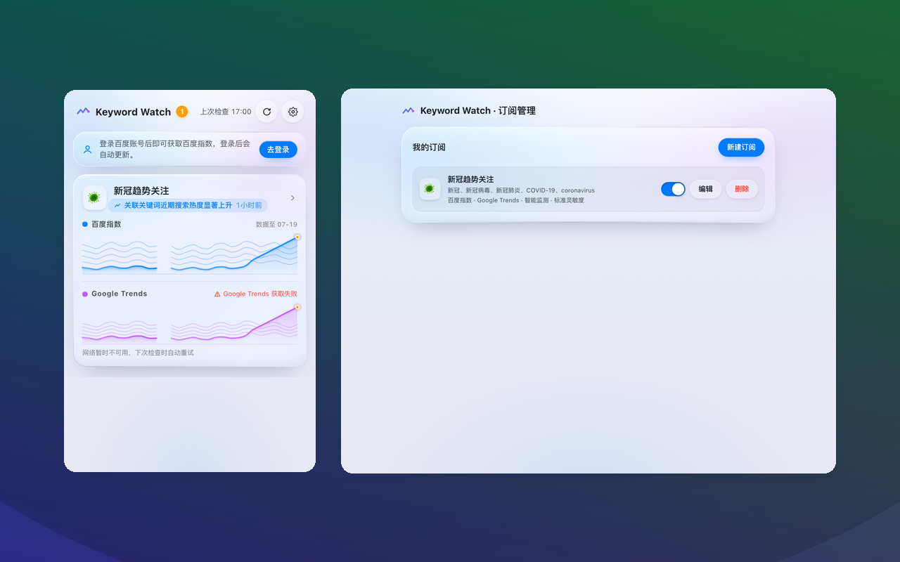

# Keyword Watch 关键词趋势监测

[](./LICENSE)
[](./src/manifest.config.js)
[](https://github.com/baozheliu/keyword-trend-monitor/actions/workflows/ci.yml)

一个 Manifest V3 浏览器扩展（Chrome / Edge）：订阅一组关键词，定期读取**百度指数**与
**Google Trends** 网页数据，在 Popup 中以液态玻璃卡片展示趋势图，并在搜索热度出现显著变化时
通过扩展角标提醒。**所有配置、历史数据与告警算法均在浏览器本地运行，不使用任何计算服务端。**



## 功能

- 最多 5 个订阅，每个订阅最多 5 个关键词；可分别启用百度指数 / Google Trends 并选择地区
- 7 种告警模板（智能监测、快速升温、持续上升、趋势反转、异常下降、剧烈波动、自定义规则）
  × 3 档灵敏度（高 / 标准 / 低）
- 本地算法簇：涨跌幅、Median/MAD、IQR、移动平均、趋势斜率、EWMA、CUSUM、连续涨跌计数、
  均线交叉、PELT 变点检测（见 [ALGORITHM_SOURCES.md](./ALGORITHM_SOURCES.md)）
- 学习阶段：数据不足时只画图不打扰；数据积累后逐级启用完整算法
- 每小时自动检查（浏览器恢复运行后立即补做一次）、手动刷新、角标未读计数
- 默认订阅「新冠趋势关注」（可修改、可删除）
- 液态玻璃 UI：SVG 折射滤镜、旋转受光边缘环、扫过高光、指针光斑，浅色/深色主题，
  尊重 `prefers-reduced-motion`

## 安装与开发

需要 Node.js 20+ 与 npm 10+。

```bash
npm install
npm run build          # 或 build:chrome / build:edge
```

然后在 `chrome://extensions`（或 `edge://extensions`）打开开发者模式，
「加载已解压的扩展程序」选择 `dist/` 目录。

百度指数需要用户已在浏览器中登录 index.baidu.com；Google Trends 无需登录。
数据获取失败只会显示“获取失败”状态，绝不会被算作趋势下降。

## 测试

```bash
npm run test           # 单元测试 + 时间顺序回测
npm run test:e2e       # 构建后加载进真实浏览器（需要本机 Edge/Chromium）
npm run check          # manifest 校验 + 类型检查 + 测试 + 构建
```

## 目录结构

```
src/
  core/        算法与领域模型（纯 TypeScript，可独立测试）
    stats/     基础统计与检测器（EWMA、CUSUM、PELT 等）
    detect/    特征提取、模板规则、告警生命周期、订阅评估
  data/        百度指数 / Google Trends 抓取与解析
  store/       chrome.storage.local 仓库层
  background/  Service Worker：定时检查、消息路由、角标
  pages/       popup 与 options（Vue 3）
  components/  玻璃面板、趋势图、图标等共享组件
tests/
  unit/        算法单元测试（含上游同输入同期望的交叉校验）
  backtest/    walk-forward 回测（精确率/召回率/误报率目标断言）
  e2e/         真实浏览器扩展环境测试（puppeteer-core + Edge）
```

## 隐私与限制

- 仅申请 `storage`、`alarms`、`cookies` 权限与两个数据源的主机权限；无内容脚本、无远程代码
- `cookies` 权限只用于感知"用户已登录百度"（观察 BDUSS 会话 Cookie 是否出现，登录后立即恢复抓取），不读取、不保存 Cookie 内容
- 不提供系统通知；不合并/比较百度与 Google 的数值；不保存与订阅无关的用户数据
- 百度指数与 Google Trends 均为非公开 API 的网页接口，页面改版可能导致获取失败（界面会如实显示）

详细的数据处理、第三方传输与删除说明见[隐私政策](./docs/privacy-policy.md)。

## 贡献与安全

欢迎贡献。提交 Issue 或 Pull Request 前请阅读 [CONTRIBUTING.md](./CONTRIBUTING.md) 与 [CODE_OF_CONDUCT.md](./CODE_OF_CONDUCT.md)。

安全相关问题请按 [SECURITY.md](./SECURITY.md) 私下报告，不要在公开 Issue 中披露可利用细节。

## 数据源与商标说明

本项目不是百度或 Google 的官方产品，也不受其赞助或认可。相关名称和商标归各自权利人所有。数据来自网页接口，可能随服务变更而失效；使用者应自行遵守数据源服务条款、账号政策和所在地法律。算法来源与许可证说明见 [ALGORITHM_SOURCES.md](./ALGORITHM_SOURCES.md)。

## License

[MIT](./LICENSE) © baozheliu
